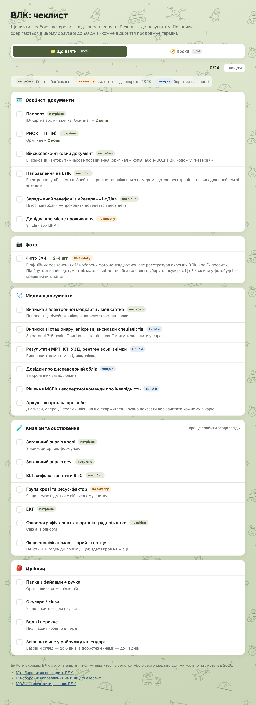
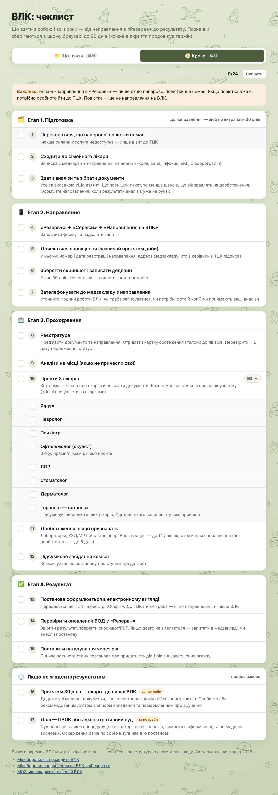

# ВЛК: чеклист

Одна HTML-сторінка з чеклистом для проходження ВЛК (українською): що взяти з собою і всі кроки від підготовки та направлення в «Резерв+» до отримання результату.

## Що всередині

- **Що взяти** — особисті документи (з кількістю копій), фото, медичні документи, аналізи й обстеження, дрібниці.
- **Кроки** — підготовка → направлення в «Резерв+» → проходження ВЛК → результат → оскарження. Лікарі відмічаються окремо в списку, що розгортається (терапевт останнім).
- Прогрес-бар для кожної вкладки, фон у стилі шпалер Telegram, світла й темна теми.
- Відмітки зберігаються в `localStorage` браузера на 90 днів (кожне відкриття продовжує термін).

| Що взяти | Кроки |
|---|---|
|  |  |

## Запуск

Без збирання й залежностей: відкрийте `public/index.html` у браузері.

## Деплой на Cloudflare

Статичний сайт, який роздається через Workers Assets (налаштування в `wrangler.jsonc`, папка `public/`).

- **З GitHub:** Cloudflare → Workers & Pages → Create → підключити цей репозиторій. Команда збирання не потрібна, деплой: `npx wrangler deploy`.
- **З консолі:** `npx wrangler login`, потім `npx wrangler deploy`.

## Примітка

Інформацію зібрано з відкритих джерел (Міноборони, МОЗ) станом на листопад 2026. Вимоги окремих ВЛК можуть відрізнятися, тому уточнюйте в медзакладі з направлення.
